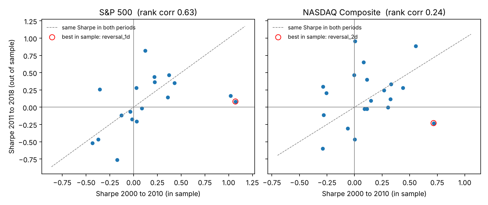
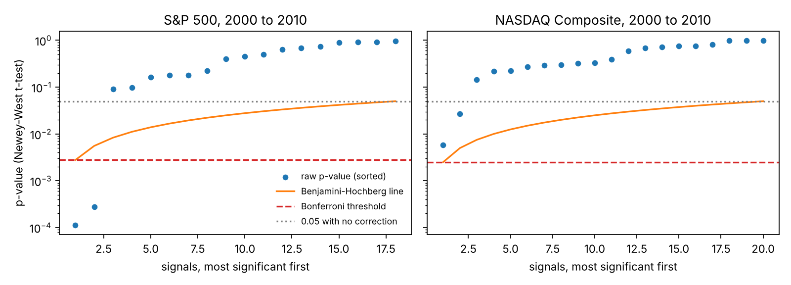
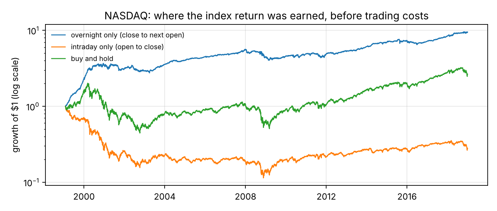
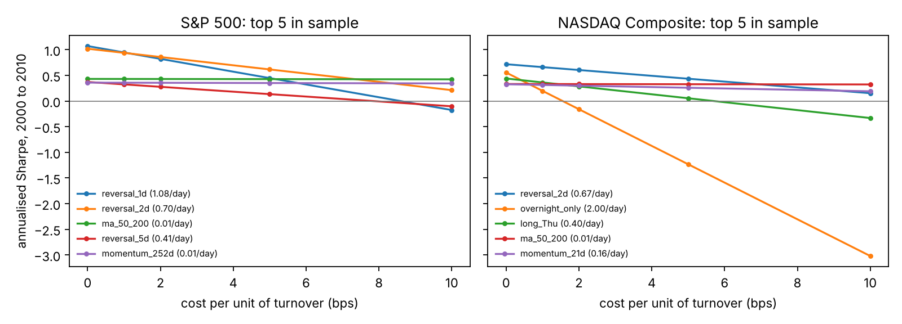
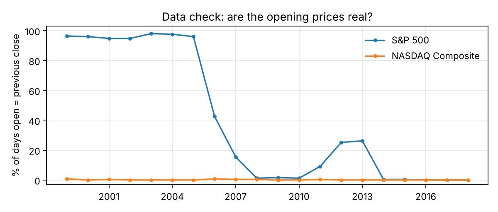
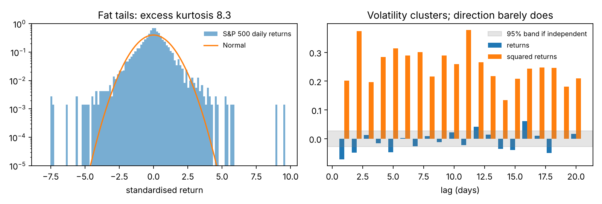

# Signal Robustness Lab

**Do simple trading signals survive honest statistical testing?**


I tested 20 classic daily signals on the S&P 500 and NASDAQ Composite (1999 to 2018, about 5,000
trading days each): momentum, short-term reversal, moving average crossovers, day-of-week effects
and overnight versus intraday returns. Each signal is chosen on 2000 to 2010 and judged once on
2011 to 2018. The project's focus is the statistics. I use Newey-West t-tests, block bootstrap
confidence intervals, corrections for testing many signals at once, Hansen's SPA test for data
snooping, and a check of how much trading cost each edge can survive.

## What I found

**1. The best signal from 2000 to 2010 disappeared afterwards, even though it passed every test.**
Betting against yesterday's S&P 500 move had a Sharpe ratio of 1.07 from 2000 to 2010 (95% bootstrap
interval 0.54 to 1.63, Newey-West t = 3.86). It survived the Bonferroni correction (p = 0.002), and
Hansen's SPA test confirmed that some signal beat cash after accounting for the search (p = 0.0015).
From 2011 to 2018 the same rule had a Sharpe of 0.08 (p = 0.80) and ranked 10th of 18.
Statistical significance in one regime is not a promise about the next.



**2. Without a multiple testing correction, I would have "discovered" things that are not there.**

| Signal | Period | Raw p | Benjamini-Hochberg p | What happened |
|---|---|---:|---:|---|
| NASDAQ, 2 day reversal | 2000 to 2010 | 0.006 | 0.115 | Lost money from 2011 to 2018 (Sharpe -0.23, 17th of 20) |
| S&P 500, long on Tuesdays | 2011 to 2018 | 0.014 | 0.226 | Nothing in 2000 to 2010 (p = 0.68) |

With 18 to 20 signals tested, about one should look significant at 5% by chance alone. The
corrections, and the SPA test on the best signal, are what separate luck from evidence.



**3. One effect is statistically real but cannot be traded: NASDAQ's return is earned overnight.**
Holding NASDAQ only from the close to the next open had a Sharpe of 0.89 from 2011 to 2018
(p = 0.002, still 0.038 after Bonferroni, SPA p = 0.0095). It was also positive from 2000 to 2010.
Before costs, $1 held only overnight grew to $9.48 between 1999 and 2018, against $0.28 held only
during the day and $2.65 buy and hold. But the strategy trades twice a day. Its edge
is used up at 1.75 basis points per trade, and at 2 basis points the Sharpe ratio is -0.13.
This is a measurement of where returns come from, not a strategy.



| | Sharpe at 0 bps | 1 bp | 2 bps | 5 bps | Break even |
|---|---:|---:|---:|---:|---:|
| S&P 500 1 day reversal, 2000 to 2010 (1.08 units of turnover a day) | 1.07 | 0.95 | 0.82 | 0.45 | 8.6 bps |
| Same signal, 2011 to 2018 | 0.08 | -0.10 | -0.27 | -0.81 | 0.5 bps |
| NASDAQ overnight only, 2011 to 2018 (2 trades a day) | 0.89 | 0.38 | -0.13 | -1.65 | 1.75 bps |



**4. A data check caught a vendor artifact before it could fake a result.**
In this S&P 500 data, the open equals the previous close on 96% of days from 1999 to 2005.
A real index almost never does that, so the vendor copied the close into the open. Any overnight
or intraday result for the S&P 500 would have been meaningless, so I excluded those two
signals there and ran them only on NASDAQ, where opens are genuine (under 1% of days).



**5. Daily returns break the textbook assumptions, which is why the tests are built as they are.**
S&P 500 daily returns have excess kurtosis of 8.3. There are 29 days beyond 4 standard deviations,
where a normal distribution would expect 0.3. Squared returns are strongly autocorrelated
(ARCH LM p < 1e-200): volatility clusters. Ordinary t-tests and independent bootstraps would
understate the uncertainty, so I used Newey-West standard errors and a stationary block bootstrap.



**6. I checked the library as well as the data.** In `arch` 8.0.0, the SPA test returned the same
p-values with studentization on and off. Without studentization the test is dominated by the most
volatile signals. I implemented Hansen's studentized statistic directly and added a unit test
showing that a noisy zero-mean signal cannot hide a precise real edge. On NASDAQ from 2011 to 2018,
the two versions give 0.0095 and 0.18. Both are saved in `results/summary.json`.

## What this would mean on a trading desk

* Select on one period and judge on another. A strong t-statistic in sample was no protection here.
* Correct for the number of ideas tried, and report how many were tried.
* Report the break-even cost next to the Sharpe ratio. High-turnover edges live or die on execution.
* Track signal quality on a rolling basis (see `figures/rolling_sharpe.png`), because edges decay
  when the regime changes.
* Check the data before the model. Copied opens would have produced a fake overnight effect.

## Method

| Step | Choice | Why |
|---|---|---|
| Data | Daily OHLC, S&P 500 and NASDAQ Composite, 1999 to 2018, shipped with the `arch` package | Real prices, reproducible offline |
| Timing | Position decided at the close of day t, held over day t+1 | No look-ahead (unit tested) |
| Signals | Momentum (5 to 252 days), reversal (1, 2, 5 days), 4 moving average crossovers, 5 day-of-week, overnight only, intraday only | Classic, simple, many: a realistic multiple testing problem |
| Periods | Choose on 2000 to 2010, judge on 2011 to 2018; 1999 is warm up | Every signal has full history in both periods |
| Significance | Newey-West t-test on mean daily return | Returns are autocorrelated and heteroskedastic |
| Uncertainty | Stationary bootstrap (mean block 10 days, 2,000 draws) for Sharpe intervals | Keeps volatility clusters together |
| Many signals | Bonferroni, Benjamini-Hochberg, studentized SPA (Hansen 2005) | Family-wise error, false discovery rate, and the best of many |
| Costs | Cost per unit of turnover: a flip from short to long is 2 units; the overnight strategy trades twice a day | Shows the break-even cost for every signal |

A detailed explanation of every decision, with likely interview questions, is in
[docs/WALKTHROUGH.md](docs/WALKTHROUGH.md). The full per-signal tables are in `results/`.

## Reproduce

```bash
pip install -r requirements.txt
python scripts/run_study.py     # about 30 seconds; data ships with the arch package
pytest -q
```

## Repository structure

```
src/signal_lab/
  data.py        load prices, compute returns, check opening prices
  signals.py     the signal family, all decided at the close
  backtest.py    positions to returns, turnover and costs
  stats.py       Newey-West tests, bootstrap intervals, multiple testing, studentized SPA, stylised facts
scripts/run_study.py   runs everything, writes results/ and figures/
tests/                 no look-ahead, cost accounting, test power and size, SPA studentization
docs/WALKTHROUGH.md
```

## Limitations

* An index cannot be traded directly. A real test would use an ETF or futures, with their own spreads and fees.
* Index levels exclude dividends, so buy and hold returns are understated.
* Index opening prints can be stale, because not every stock trades at the open. This could
  bias the measured overnight return, so the overnight result needs confirming on ETF or futures prices.
* The cost model is a flat cost per unit of turnover, with no market impact or spread variation.
* One split into two periods. Rolling or multiple splits would show stability better.
* The Tuesday effect appeared from 2011 to 2018 in both indices. It was absent before, and I have
  no economic explanation for it, so I treat it as unconfirmed.

## References

* Newey, W. and West, K. (1987). A simple, positive semi-definite, heteroskedasticity and autocorrelation consistent covariance matrix. Econometrica.
* Politis, D. and Romano, J. (1994). The stationary bootstrap. Journal of the American Statistical Association.
* Benjamini, Y. and Hochberg, Y. (1995). Controlling the false discovery rate. Journal of the Royal Statistical Society B.
* White, H. (2000). A reality check for data snooping. Econometrica.
* Hansen, P. R. (2005). A test for superior predictive ability. Journal of Business and Economic Statistics.
* Cliff, M., Cooper, M. and Gulen, H. (2008). Return differences between trading and non-trading hours: like night and day. Working paper.
* Harvey, C., Liu, Y. and Zhu, H. (2016). ... and the cross-section of expected returns. Review of Financial Studies.

## Author

Brijesh Dangwal, Master of Computer Science (Data Science and AI), University of Sydney.
[GitHub](https://github.com/BrijeshDangwal)
